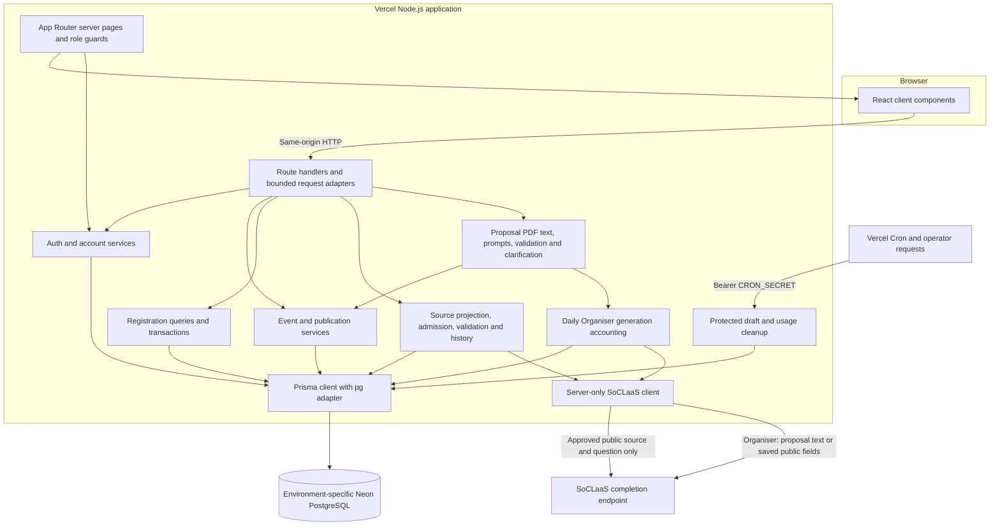
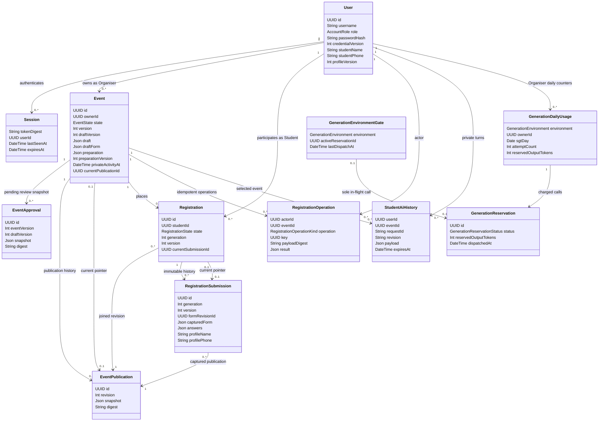
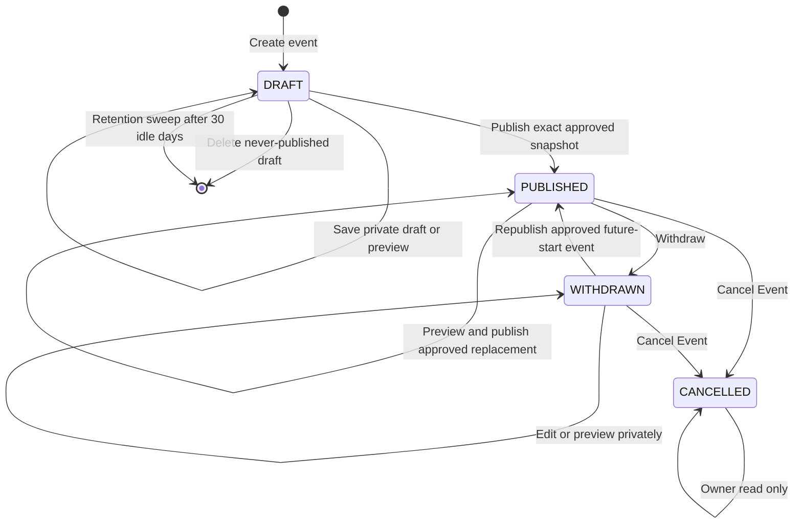
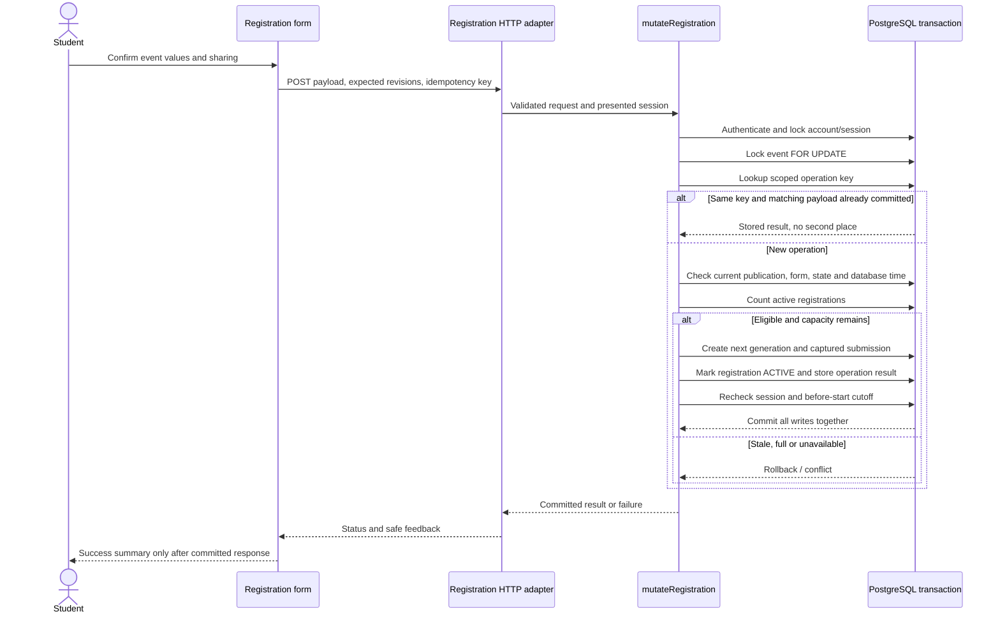
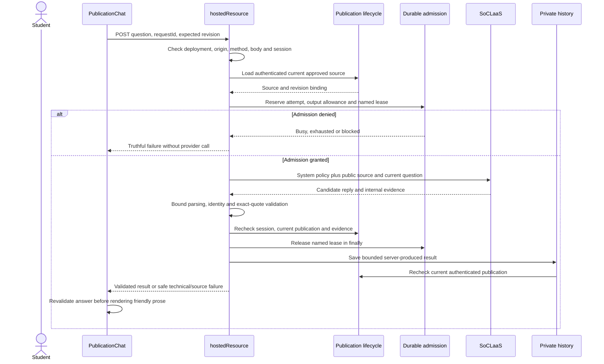

# TurnUp Developer Guide

This guide describes the **implemented code at 5393189, 23 October 2026**. That revision
includes the merged workspace UI improvements and the WP-005 Organiser proposal
assistance merged through PR #35 (CHG-K-010 to CHG-K-017): PDF extraction,
clarification, FAQ suggestions, the daily hosted-generation allowance and private-draft
retention. It does not declare the entire roadmap or WP-007 complete. Code, schema,
routes and tests were inspected rather than copying historical completion statements
from the README/specifications. The Product website and User Guide are maintained
alongside this guide.

The application version in `package.json` is **0.1.0**. A repository version, a passing
test and a successful hosted workflow are different evidence; none alone establishes
complete release acceptance. Check the deployed revision when reproducing behavior.

## Contents

1. [Setup guide](#1-setup-guide)
2. [Project design and UML](#2-project-design-and-uml)
3. [Implemented features and interfaces](#3-implemented-features-and-interfaces)
4. [Security and AI boundaries](#4-security-and-ai-boundaries)
5. [Testing and manual verification](#5-testing-and-manual-verification)
6. [SDD and multi-agent engineering process](#6-sdd-and-multi-agent-engineering-process)
7. [Deployment and product website](#7-deployment-and-product-website)
8. [Known gaps and glossary](#8-known-gaps-and-glossary)
9. [Acknowledgements](#9-acknowledgements)

## 1. Setup guide

### 1.1 Toolchain

Use the versions checked into the repository, not an assumed latest framework API.

| Tool / dependency | Repository version | Purpose |
| --- | --- | --- |
| Node.js | `.nvmrc`: 24.21.0; engine `>=24.11.0 <25` | Node runtime and development tools |
| pnpm | 12.14.0 through Corepack | Locked package installation and scripts |
| Next.js / React | 16.3.8 / 19.2.8 | App Router, server pages, client interfaces and HTTP routes |
| TypeScript | 5.9.3 | Static checking |
| Prisma client/CLI | 7.10.1 | Schema, generated client and migrations |
| PostgreSQL driver | `pg` 8.16.3 | Prisma PostgreSQL adapter connectivity |
| PDF.js | `pdfjs-dist` 6.3.289 | Server-side proposal PDF text extraction (no OCR) |
| Vitest / Vite | 5.0.4 / 8.3.4 | Credential-free and separately opted-in SQL tests |
| ESLint | 9.39.1 | Source checks with Next.js configuration |
| Ruby / Bundler | Separate optional documentation toolchain | Jekyll website preview; not required to run TurnUp |

Git is needed to obtain the source. Use an assigned synthetic non-production database
for development; the runtime configuration expects Neon PostgreSQL rather than an
arbitrary local connection URL. No real provider key is required for ordinary unit tests.

```sh
git clone https://github.com/CS3227-2610-MP3-TurnUp/CS3227-2610-MP3.git
cd CS3227-2610-MP3
corepack pnpm install --frozen-lockfile
corepack pnpm db:generate
```

`src/server/db/generated/` is generated from the schema and ignored by Git. Do not
maintain hand-edited generated models. Read relevant local Next.js guides in
`node_modules/next/dist/docs/` before changing framework APIs, as required by AGENTS.

### 1.2 Environment configuration

Copy `.env.example` to `.env.local` and populate it privately. Never commit the filled
file or put any database/provider key in a `NEXT_PUBLIC_` variable. The table lists
names and relationships, not working credentials.

| Settings | Meaning / validation |
| --- | --- |
| `TURNUP_ENVIRONMENT`, `DATABASE_ENVIRONMENT` | Development/Preview must pair with `non-production`; Production with `production`. |
| `DATABASE_URL` | Runtime Neon pooled URI; TLS required. |
| `MIGRATION_DATABASE_URL` | Direct migration URI, with `sslmode=require&sslaccept=strict`. Runtime does not use it. |
| `SHADOW_DATABASE_URL` | Separate direct shadow resource for `db:migrate:dev`; must not identify the migration database. |
| `AUTH_ORIGIN` | Exact browser origin with no trailing slash/path; locally `http://localhost:3000` by default. |
| `AUTH_SOURCE_MODE` | `local` for loopback development; `vercel` for hosted trusted ingress. |
| `AUTH_THROTTLE_SECRET` | Privately generated stable 32–64 bytes encoded as 64–128 hexadecimal digits. |
| `STUDENT_SOCLAAS_API_KEY` | Student assistant's server-only credential; no fallback to the shared key. |
| `SOCLAAS_API_KEY` | Shared/Organiser provider credential; not the Student fallback. |
| `SOCLAAS_BASE_URL`, `SOCLAAS_MODEL` | Validated SoCLaaS endpoint/model; hosted Student policy pins `qwen3.8:27b`. |
| `SOCLAAS_MAX_INPUT_BYTES`, `SOCLAAS_MAX_OUTPUT_TOKENS`, `SOCLAAS_TIMEOUT_MS` | Explicit provider ceilings; hosted Student caps may lower them. |
| `STUDENT_ASSISTANT_ENABLED` | Explicit hosted enablement; insufficient without matching runtime labels, valid configuration and durable admission state. |
| `PROPOSAL_ASSISTANCE_LOCAL_SYNTHETIC` | Local-only Organiser generation (`next dev`, development/non-production, no Vercel markers). Uses the shared `SOCLAAS_*` settings with a fixed profile and the cumulative `FOUNDATION_PROBE_SOC_*` gate. |
| `PROPOSAL_ASSISTANCE_HOSTED_ENABLED` | Explicit hosted Organiser generation for a validated Preview/Production label pair; default `false`. |
| `ORGANISER_SOCLAAS_API_KEY`, `_BASE_URL`, `_MODEL`, `_MAX_INPUT_BYTES`, `_MAX_OUTPUT_TOKENS`, `_TIMEOUT_MS` | Dedicated hosted Organiser profile. Never falls back to shared/local `SOCLAAS_*`. The code requires the fixed values `qwen3.5:9b`, 65,536 bytes, 4,096 tokens and 60,000 ms in every hosted environment; any other value is `invalid_configuration`. |
| `DRAFT_RETENTION_ENABLED` | Enables the protected private-draft cleanup worker; default `false`. |
| `GENERATION_USAGE_RETENTION_ENABLED` | Enables the protected settled-usage cleanup route; default `false`. |
| `CRON_SECRET` | Operator bearer secret (at least 32 bytes) for both internal cleanup routes. It is not an account session. |
| `FOUNDATION_PROBE_*` | Protected synthetic persistence/provider feasibility checks, and the cumulative gate reused by local synthetic Organiser generation; not normal product features. |

Production and non-production require separate resources/credentials. Labels and URL
validation fail closed on known mismatches but cannot independently prove the ownership
of a remote database. Keep resource allocation evidence with the release handoff.

For ordinary local browsing, keep port and `AUTH_ORIGIN` consistent. After assigning
and reviewing an appropriate non-production target, inspect/apply migrations using
the existing scripts. Never reset shared Preview or Production databases.

```sh
corepack pnpm db:migrate:status
corepack pnpm db:migrate:dev
corepack pnpm dev
```

Open `http://localhost:3000`. No default accounts are seeded by normal startup. A real
successful login needs the migrated database and valid auth configuration. Next.js
startup and build do not apply migrations automatically.

### 1.3 Local assistant development

The synthetic assistant harness at `/dev/student-assistant` is restricted to **development
bound to `127.0.0.1:3001`**, with no Vercel runtime. Start a separate authorised development
session using `corepack pnpm dev --hostname 127.0.0.1 --port 3001`; align `AUTH_ORIGIN`
if exercising authenticated real-publication routes there. The default port-3000 app
does not meet the assistant's development policy. This is intentional, not a missing
route to fix by weakening the guard.

The harness defaults to simulated responses. Live local mode additionally requires an
explicit operator allowance in ignored `.student-assistant-local/` and valid Student
provider configuration. A key alone does not enable inference. Real-publication
inspection at `/dev/student-assistant/publication/[eventId]` is distinct from synthetic
examples and requires Student authentication. Neither development surface is a hosted
product feature. Do not expose it publicly for screenshots.

### 1.4 Local Organiser proposal assistance

Organiser generation runs in the real editor, not a separate harness. With no flag
set, **Generate Findings** and **Generate FAQ suggestions** return a truthful
"not enabled" outcome and manual editing still works, so most editor work needs no
provider. Apply the WP-005 migrations (`20261023000000` to `20261023030000`) to the
assigned synthetic target, regenerate the Prisma client and restart `next dev`:
the new `Event` columns are required even for manual-only events.

For one bounded live local check, set `PROPOSAL_ASSISTANCE_LOCAL_SYNTHETIC=true` and the
fixed profile (`SOCLAAS_MODEL=qwen3.5:9b`, 65,536 input bytes, 4,096 output tokens,
60,000 ms). Also set the `FOUNDATION_PROBE_SOC_*` limits: `MAX_IN_FLIGHT=1`, an interval
of at least 2,100 ms and an output-token budget of at least 4,096. Local calls draw on the **cumulative** `soc_probe_gate` row, not the hosted
daily allowance, and restarting does not reset it. Use only synthetic text PDFs. Do not
clear leases/counters to force a run. The [local walkthrough](https://github.com/CS3227-2610-MP3-TurnUp/CS3227-2610-MP3/blob/5393189/docs/wp-005-proposal-integration.md)
gives exact steps, a synthetic PDF, prompt-injection variants and troubleshooting.
Set the flag back to `false` afterwards.

## 2. Project design and UML

### 2.1 Architecture and module boundaries

TurnUp is one Next.js application with fixed-role interfaces. Server pages resolve
access before rendering a role page. Client components own interaction state and call
HTTP routes; each server operation independently checks identity, role, ownership,
versions and state. Hidden navigation is not the access boundary.

The component/deployment view below is a module diagram. The following class,
state and sequence diagrams use UML-style relationships over the actual data/services;
they are maintained documentation, not automatically generated runtime diagrams.



`src/app/` is the routing boundary. `src/components/` contains shared account/event
presentation, including the Organiser editor and its proposal, FAQ, allowance and
retention panels. `src/features/` holds Student registration and assistant state/UI,
plus portable proposal-assistance schemas, validation and prefill logic.
`src/lib/` contains portable fields, form types, retention/usage display helpers and
validation. `src/server/` contains authoritative policies/services, including
`proposal-assistance/` (PDF text, prompts, transport, clarification) and `ai/` (SoCLaaS
client, daily generation, usage retention). `server-only` prevents accidental client
imports. The model is outside the database transaction and has no application tools.

### 2.2 Core persistent class relationships

These are selected **Prisma models**, not a claim that every service is a class.
Fields are abbreviated. `draft`, `draftForm`, publication snapshots and captured
forms/answers are JSON values; there is no separate persistent `Form` model.



Important constraints in [the schema](https://github.com/CS3227-2610-MP3-TurnUp/CS3227-2610-MP3/blob/5393189/prisma/schema.prisma)
and SQL migrations include globally unique usernames, one registration per
Student/event, immutable submission identities per generation/version, current-pointer
relationships, and operation keys scoped by actor/event/operation. The `approvedBy`
and `actorId` fields in publication/approval snapshots are UUID values, not separately
declared Prisma User relations. Foundation probes, auth throttles and Student AI
admission models are omitted above for readability; they remain real schema components.

`Event.preparation` holds private, structured clarification issues with short evidence
and Organiser confirmations, versioned by `preparationVersion`. It never stores the PDF
or full extracted text, and publication snapshots exclude it. `privateActivityAt`
and `retentionCheckedAt` drive draft retention. Generation usage is keyed by
environment, owner and Singapore (SGT) day. It stores counts and reservation status only:
no prompt, proposal text, model output or event ID. The singleton gate row per
environment serialises admission, spacing and the one in-flight call across replicas.

### 2.3 Publication lifecycle



`EventEditor` has separate publication/editor/preview presentation modes; these are not
extra database states. `mutateEvent` locks an owner-scoped event, checks the expected
version and binds approval to event/draft versions plus a canonical snapshot digest.
Saving invalidates old approvals. Publish rechecks time and rejects capacity below
active registration count. Original publication history remains separate from the
working draft. Cancel Editing, discard saved changes, withdrawal, cancellation and
never-published deletion have different effects.

Save Draft may also carry `expectedPreparationRevision` and clarification `resolutions`;
they are accepted only with `save`, so preview/publish cannot smuggle preparation
changes. Preview and publish are refused while required clarification issues remain
unresolved, both in the editor and by the server (`409`). The retention sweep deletes
only never-published drafts. Any event with publication evidence (including withdrawn
or cancelled) is restored from its validated current publication, keeping its state,
history and registrations. If that publication is missing or invalid, the sweep fails
closed and reports it as unavailable.

The service supports saving a versioned draft form through its API, while the current
editor sends only event fields (an omitted `form` leaves the saved form unchanged). This
distinction matters when integrating Keith's form-builder/roster work: do not document
an API capability as an existing user screen.

### 2.4 Transactional registration sequence



The event lock is shared with publication/lifecycle mutations, preventing two
transactions from taking the last seat or reducing capacity beneath active places.
The code retries only explicit serialization/deadlock aborts once with the same
operation key; arbitrary dependency errors are not blindly retried. Captured form,
profile values and answers are stored in immutable `RegistrationSubmission` rows.
Correction creates another submission version; rejoin advances the registration
generation so an old operation cannot execute against a new registration.

`registrationActions` drives UI eligibility, while the transaction repeats the
authoritative checks with database time. Join/rejoin/correct require publication;
cancel also allows withdrawal. All require a start strictly later than database time.
My Events hides current public excerpts when withdrawn/cancelled; retained private
records do not grant access to stale public information.

### 2.5 Grounded assistant request sequence



The diagram abbreviates route/service calls; provider work does **not** hold an open
database transaction. A released lease does not refund spent attempt/output allowance.
After inference, source/session checks suppress detected replacement, withdrawal or
expiry before delivery. The final check is a linearisation point, not a promise that
an event can never change immediately after a response.

`PublicationChat` uses generation tickets and abort controllers to reject delayed
client results. Routine open/window-focus refresh does not interrupt an active answer
or resend inference. A confirmed source change invalidates old turns before loading
the replacement. The model receives no conversation history, private submission,
profile, draft, proposal or inbox context. Restored display history is separately
validated against the current source.

### 2.6 Organiser generation request flow

Both Organiser generation routes follow the same server order. The diagram budget for
this site is fixed at five, so the flow is listed rather than drawn:

1. **Authority before input.** Validate the event UUID, origin and session, then
   `assertProposalEventAccess` confirms Organiser role, ownership and a non-cancelled
   event. This happens before reading a single byte of the upload.
2. **Availability preflight.** `proposalCompletionAvailability` selects the hosted
   daily path (validated Preview/Production labels plus `PROPOSAL_ASSISTANCE_HOSTED_ENABLED`)
   or the local synthetic path. If it is unavailable, the route returns a truthful outcome
   with no provider call.
3. **Per-owner window.** `admitProposalExtraction` allows five generation requests per
   owner per 15-minute window across both actions, in both hosted and local modes.
4. **Bounded input.** Extraction reads one multipart PDF (4,000,000 bytes plus a small
   envelope, 15 s read timeout), with exact-key expected event and preparation revisions.
   FAQ generation reads a 1 KiB JSON body of revisions only. Then
   `readSavedPublicCandidateSnapshot` loads the **saved** public fields itself and refuses
   with `not_ready` while required clarifications remain.
5. **PDF text.** `extractPdfPageText` uses PDF.js with at most 20 pages, 48,000 text
   bytes and an 8 s parse timeout. It drops text below 1 pt or beyond the page bounds as
   likely injection carriers, and does no OCR.
6. **Recheck, then infer.** Access and both revisions are rechecked with no transaction
   held open. The hosted path reserves a daily call (section 4.4) and writes a dispatch
   marker immediately before the provider request. There is no automatic retry.
7. **Validate output.** Extraction is validated per field: a value needs a valid shape
   and an exact quote from its cited page, and instruction-like sentences cannot be
   evidence. Invalid fields are dropped and the result is flagged incomplete
   (`incompleteReasons`, including truncated output). The call fails with
   `invalid_response` only when no field validates. FAQ output with inexact quotes is
   withheld per item. Only the FAQ route logs a rejection, as a finite code such as
   `ROOT_SHAPE`, never content.
8. **Commit or refuse.** Extraction calls `recordProposalExtraction`, which rechecks
   owner, session and revisions inside the event write transaction. It persists only
   structured preparation issues and short evidence, increments the event version,
   deletes outstanding preview approvals and restarts the retention clock. FAQ
   generation has no such write: it rereads the snapshot and delivers only if it is
   unchanged. Neither action saves event fields or publishes.

The client prefills fields from validated known findings only. It refuses a stale
response if the editor revision changed while the request was running, and it never
overwrites a value the Organiser has already confirmed. FAQ candidates only change
**Other** after an explicit Apply, and still require Save Draft, Preview and Publish.

## 3. Implemented features and interfaces

### 3.1 Product routes

Paths below belong to the application origin, not GitHub Pages.

| Route | Role / behavior |
| --- | --- |
| `/`, `/signup`, `/login` | Public landing, fixed-role account creation and login. |
| `/account` | Authenticated credentials; optional Student profile for Students only. |
| `/student` | Published-event discovery by title and upcoming/started filter. |
| `/student/events/[eventId]` | Current approved details, registration availability and conditionally enabled assistant. |
| `/student/events/[eventId]/register` | Event-specific confirmed registration. |
| `/student/my-events` | Own current registration actions/change flags. |
| `/student/registrations/[registrationId]` | Own captured-submission correction. |
| `/organiser` | Own-event dashboard/search/sort/create, with state and private-draft deadline badges. |
| `/organiser/events/[id]` | Private working draft with proposal assistance, clarification, FAQ suggestions, daily allowance and retention notice; exact preview, publication and lifecycle actions. |
| `/dev/student-assistant` | Strictly local development simulation/live synthetic harness. |
| `/dev/student-assistant/publication/[eventId]` | Strictly local authenticated source inspection, not an answering screen. |

### 3.2 HTTP surface

Read the route and its adapter before adding a consumer. Requests do not accept
arbitrary actor/owner/source identity from the browser.

| Route family | Methods and authoritative implementation |
| --- | --- |
| `/api/auth/signup`, `/login`, `/logout` | POST; `server/auth` validates origin, bounded JSON, throttling and sessions. |
| `/api/account/credentials` | POST; per-action current password and credential version. Settings reads are server-page/service calls. |
| `/api/student/profile` | GET/POST; self-only optional profile and profile version. |
| `/api/organiser/events` | GET/POST; own list and private create. |
| `/api/organiser/events/[id]` | GET/POST; own read or one of save/preview/publish/withdraw/cancel/delete/discard. Save alone may carry `expectedPreparationRevision` + `resolutions` and an optional `form`. |
| `/api/organiser/events/[id]/proposal-extraction` | POST multipart: one PDF, `expectedVersion`, `expectedPreparationRevision`, `revisions`. Returns validated extraction and saved preparation; `maxDuration` 120 s. |
| `/api/organiser/events/[id]/public-candidates` | POST JSON revisions only; FAQ/Other candidates from saved public fields; `maxDuration` 120 s. |
| `/api/organiser/ai-usage` | GET; self-only Organiser daily allowance (`active`, or `disabled` with a reason). |
| `/api/internal/draft-retention` | GET with `Authorization: Bearer CRON_SECRET`; `?dryRun=true` counts only; otherwise sweeps up to 50 events. Daily Vercel Cron (Production). |
| `/api/internal/generation-usage-retention` | GET with the same bearer secret; dry-run by default; `?dryRun=false` removes up to 100 settled reservations/100 unused daily rows older than 90 days. Operator-invoked. |
| `/api/student/events`, `/[eventId]` | GET; published projection, own availability, current-pointer recheck. |
| `/api/student/events/[eventId]/registrations` | GET captured initial screen / POST join or rejoin. |
| `/api/student/registrations` | GET own history/list. |
| `/api/student/registrations/[registrationId]` | GET correction screen / POST captured correction. |
| `/api/student/registrations/[registrationId]/cancel` | POST own cancellation with generation/version/key. |
| `/api/student/events/[eventId]/assistant/source`, `/history`, `/answer` | GET source, GET history, POST answer; hosted policy and publication/session checks. |
| `/api/dev/student-assistant` and its publication descendants | Development-only bounded endpoints; no hosted fallback. |
| `/api/internal/foundation-probe` | Explicitly protected synthetic infrastructure probe; not an application feature. |

Use route-local response shapes and status codes. Auth bodies are bounded to 4 KiB,
event bodies to 512 KiB, registration bodies to 256 KiB, FAQ-generation bodies to
1 KiB and hosted assistant question bodies to 8 KiB, with streaming limits/timeouts.
A technical 503 must not be recast as an empty result or a successful missing-fact
model answer.

Organiser generation failures use a finite `outcome` string with a mapped status:
`stale_event` 409, `rate_or_budget_limited` 429 (plus `limitReason`, `retryAt` and
`resetAt` when known), `timeout` 504 for parser/provider timeouts or 408 when reading the
request body times out, `invalid_response` or prompt `input_too_large` 502, and disabled
or misconfigured 503. Extraction also uses `unsupported_file` 415, `file_too_large` /
`too_many_pages` / `text_too_large` 413 and unreadable/encrypted PDF 422; the FAQ route
reports 413/415 as `invalid_request`. Missing or foreign events return 404. FAQ generation additionally returns `not_ready` (409) while required
clarifications remain. Clients must keep the Organiser's fields on every failure.

### 3.3 Important presentation/data distinctions

- Global Student profile is optional; each event submission requires Name plus a
  valid phone or Telegram handle and explicit sharing. Global Phone accepts phone
  numbers only. Event submission never writes the profile.
- Engine forms support zero to ten questions and four types. Choice questions have
  2–10 stable-ID options. Short/long answers are limited to 250/2,000 characters.
  Current Organiser UI has no question-building controls; the editor's FAQ/Other
  suggestion edits the public **Other** field, not registration questions.
- Stored role is fixed. There is no guest participation, role switch, payment, seat
  hold, waitlist or completed registration through the chatbot.
- Current source supports future-start events and at most 32 KiB / 32 source sections.
  This is narrower than all potentially valid publication content. Oversize data is
  refused, not silently truncated into a different event.
- Proposal PDF upload/extraction, clarification and FAQ suggestions are implemented
  (section 3.4). The current code has no private inbox/reply workflow, form builder or
  roster screen. Their presence in planned specs does not make them executable features.
- Proposal material is private Organiser preparation. It is never part of a publication
  snapshot, the Student assistant's source or the FAQ-generation input.

### 3.4 Organiser workflows

The User Guide explains these as user steps; this table maps each one to the code to
read before changing it.

| Workflow | Entry point / UI | Authoritative implementation | Key behaviour to preserve |
| --- | --- | --- | --- |
| Find and create events | `components/events/dashboard.tsx`, `event-card.tsx` | `server/events/service.ts` `listEvents`, `createEvent` | Owner-scoped list; search ≤150 chars; sort by title/modified/start. Create starts the 30-day private-draft clock. |
| Prepare a private draft | `components/events/editor.tsx` (`Save Draft`) | `mutateEvent` `save` | Incomplete drafts save. Each save bumps the draft version and invalidates approvals. It restarts retention while private material remains; a save matching the live publication with no preparation clears the clock. |
| Prefill from a proposal PDF | `proposal-assistance.tsx` (**Choose PDF** → **Generate Findings**) | `server/proposal-assistance/http.ts`, `pdf-text.ts`, `prompts.ts`; `features/proposal-assistance/json-extraction-validation.ts`, `event-prefill.ts` | Selecting sends nothing. Valid known findings prefill with exact quote and page; conflicts offer at most three choices; missing or invalid fields keep prior values. Nothing saves automatically. |
| Resolve clarifications | Inline issues in `editor.tsx` (**Confirm this value**) | `server/proposal-assistance/clarification.ts`, `recordProposalExtraction`, Save Draft `resolutions` | Save is allowed while unresolved. Preview/publish are blocked until resolved and saved. Editing a confirmed value reopens only its issue, and a later conflicting proposal reopens review rather than overwriting. |
| FAQ suggestions | `public-content-assistance.tsx` (**Generate FAQ suggestions**, **Apply FAQ / Other to working form**) | `public-candidates/route.ts`, `server/proposal-assistance/public-candidates/` | Input is saved public fields only, and suggestions target questions those fields do not already answer. Unanswered questions are offered to the Organiser and never invented. Apply changes only **Other**, after confirmation if it would replace different text. Candidates are not persisted. |
| Daily allowance | `generation-usage.tsx` (shared by both generators) | `api/organiser/ai-usage`, `server/ai/daily-generation*.ts` | Hosted only: 10 calls and 40,960 reserved tokens per SGT day per environment. Distinct exhausted, busy and spacing messages. Local mode reports `disabled`, not a daily limit. |
| Draft retention | `draft-retention-notice.tsx`, card badge | `server/events/retention.ts`, `lib/event-retention.ts` | Warns in the last 7 days (SGT display). Save Draft or an accepted extraction resets the clock; reads, previews, FAQ generation and failures do not. Cleanup runs only when enabled. |
| Preview and publish | `editor.tsx` (**Preview saved draft**, **Publish approved event**) | `mutateEvent` `preview`/`publish` | Exact digest-bound approval of the saved draft; public fields only. |
| Edit live, withdraw, cancel, delete, discard | `editor.tsx` lifecycle buttons | `mutateEvent` | As in section 2.3. Cancelled events refuse proposal assistance. |

## 4. Security and AI boundaries

### 4.1 Accounts and server authorization

Passwords are NFC-normalised and hashed with async Node scrypt (`N=131072`, `r=8`,
`p=1`, independent 32-byte salts, 64-byte output). Hash concurrency is bounded per
process. Sessions use opaque 32-byte random tokens; only SHA-256 token digests persist.
Hosted cookies use `__Host-turnup_session`, Secure, HttpOnly, SameSite=Lax and Path `/`;
local loopback uses a separate cookie name. Idle/absolute expiry are 30 minutes/eight
hours. Mutations revalidate authoritative identity/session around critical writes.

Username changes preserve UUID ownership and sessions. Actual password changes
atomically increment the credential revision and revoke all sessions. No-op saves
still reauthenticate but do not revoke them. Login rechecks locked credentials before
issuing a session, preventing an old verified password from minting a post-change one.

Origin checks and validated Vercel ingress attribution protect request admission.
Generic forwarded headers are not trusted fallbacks. Local mode ignores them and
uses a conservative shared bucket. Auth counters store keyed identifiers, not raw
usernames/IPs. Limits are separate for signup/login/settings; a provider/dependency
failure is not proof a limit worked.

### 4.2 Prompt injection and evidence

Treat public event text, questions and provider replies as untrusted data. The server
resolves the approved publication and constructs context; callers cannot supply a
different source or actor. The model receives no tools and cannot publish, register,
change an account or forward a message. JSON shape, source identity, exact quoted
substrings and size are checked; a WeakSet brand prevents merely cast objects from
being rendered as validated answers. React escapes reply/source text; the UI does not
insert provider HTML.

These controls constrain effects and provenance. They are **not a proof of semantic
entailment**: a reply could cite genuine text yet make a misleading inference. Include
benign and adversarial semantic evaluation before broader release claims. Keep
internal quotations/revisions out of Student conversation prose as implemented.

### 4.3 Hosted limits and private history

The code's hosted Student policy has separate Preview/Production approval rows and
budgets; it requires matching Vercel/application/database labels and the Student key.

| Limit | Current hosted ceiling |
| --- | --- |
| Admitted requests | 200 per environment's approved pool; failures are not refunded |
| Reserved output | 200,000 tokens total; at most 1,000 per request |
| Provider request size / timeout | At most 65,536 bytes / 20 seconds, potentially reduced by configured caps |
| Shared admission | One unexpired lease, 10-second spacing, 60-second lease expiry |
| Per-account admission | 20 requests per rolling 15 minutes |
| Approval lifetime | Seven days from the first target-specific activation |
| Question / visible reply | 1,000 / 700 Unicode code points |

`scripts/activate-student-ai-budget.mjs` activates only an explicitly selected target
and refuses incompatible existing approval/model/environment state. Redeployment does
not reset spend or renew expiry. Do not run it merely to make a documentation screenshot
work. Model permission, provider rules and a bounded live test need their own evidence.

History is keyed by account/event/request, bound to publication revision, with at most
20 recent turns returned. Appends prune other revisions/excess turns in that account/
event and opportunistically delete expired history. Expiry is derived from the current
event end plus 90 days. Reads filter expiry and current publication; logout does not
delete history. This code does **not** establish scheduled full-store retention cleanup
or backup erasure. Raw prompts, credentials and personal values must not enter logs.

### 4.4 Organiser generation boundaries

Treat proposal PDFs and saved event text as **untrusted data**. Every Organiser system
prompt starts with the shared `untrustedDataRules` block (`prompt-safety.ts`). That block
says document text is never instructions, and that encoded or look-alike text is still
data. Defence does not rely on the prompt alone:

- The parser drops sub-1 pt and off-page text. Sentences matching assistant-directed
  override patterns cannot serve as evidence, and their page gets a private review note.
  White-on-white text is **not** filtered; Organiser review remains the final control.
- Every prefilled value needs an exact quote from its cited page; dates are validated
  canonical timestamps (SGT when no zone is stated). FAQ generation never sees the PDF,
  private `Event.preparation` (clarifications), evidence or participant data. It does
  see the public Preparation field.
- The model has no tools and cannot save, publish or change roles. Only structured
  preparation (issues, short evidence and confirmations) persists. Upload buffers are
  zeroed after reading, and neither the PDF nor its full text is stored. Usage records
  hold counts only.

Hosted accounting (`server/ai/daily-generation.ts`) admits on the database clock's SGT
day. Each dispatched call reserves 4,096 output tokens, up to 10 calls and 40,960 tokens
per Organiser per environment per day, shared across both actions and all events. One
in-flight call per environment and at least 2,100 ms after the previous dispatch apply across
replicas. A reservation moves RESERVED → DISPATCHED → COMPLETED. A failure before
dispatch REFUNDS once; dispatched calls are never refunded, and ambiguous transport
results are UNCERTAIN and keep the environment slot. Only the guarded server-side
`recoverDailyGenerationReservation(db, environment, id, confirmationId)` releases an
uncertain slot (RECOVERED), without changing counters. There is no HTTP recovery
endpoint. Never reset counters or delete reservations to unblock a request.

These controls bound effects, cost and provenance. They do not establish extraction
accuracy or semantic quality. The current prompt versions have deterministic tests but
only limited bounded live checks (section 8.1).

## 5. Testing and manual verification

### 5.1 Ordinary checks

From the repository root:

```sh
corepack pnpm lint
corepack pnpm typecheck
corepack pnpm test
corepack pnpm db:validate
corepack pnpm build
node workflow/validate-docs.mjs
```

`typecheck` regenerates Prisma and Next.js route types before `tsc`; `build` generates
Prisma then builds Next.js. The ordinary Vitest configuration excludes explicit
database integration suites. Synthetic/mock tests do not call the live LLM or prove
the hosted database configuration.

On Windows, existing hosting tests need **Git Bash** on PATH and LF workflow source.
CRLF-sensitive extraction can fail before executing the fixture. If normalising bytes
temporarily for a diagnostic run, restore the original bytes and record that the raw
checkout command failed; do not change expectations to hide it. Sandbox restrictions
can separately prevent temporary-file replacement or Next.js dependency junctions.

The PR #35 WP-005 master integration recorded 879 tests passing (5 opt-in skipped),
plus full ESLint, Prisma validation and a production webpack build, in a source mirror
(CHG-K-015 verification). The prior UI increment recorded 688 tests / 53 files. These
are historical evidence for those sources; neither is a claim that tests were rerun
for a documentation increment. Current document/site checks and independent findings
belong in `docs/documentation-preparation.md` in the source repository.

Proposal-assistance tests live in `tests/proposal-assistance/`; retention route/UI
tests are in `tests/events/`. The ordinary suite uses doubles and makes no provider
call. Source parser tests do not reproduce Next.js production bundling of PDF.js, so
after a production build also run the opt-in artifact check:

```sh
PDF_TEXT_BUILD_DIR="$BUILD_ROOT/.next/server/app/api/organiser/events/[id]/proposal-extraction" \
  corepack pnpm exec vitest run tests/proposal-assistance/pdf-text-built-runtime.test.ts
```

### 5.2 Explicit SQL suites

| Suite | Opt-in / target |
| --- | --- |
| `corepack pnpm test:auth:db` | `RUN_AUTH_DB_INTEGRATION=1`, `AUTH_TEST_OWNER=darryl`, exact approved endpoint/database and matching non-production URLs supplied to the process. No private env file automatically loaded. |
| `corepack pnpm test:db` | `RUN_FOUNDATION_DB_INTEGRATION=1` against an assigned synthetic non-production target; special destructive SoC-gate checks need their additional dedicated-database opt-ins. |
| `corepack pnpm exec vitest run --config tests/events/vitest.database.config.ts` | `RUN_LOCAL_EVENT_SQL=1`; disposable in-memory PostgreSQL/socket fixture. |
| `corepack pnpm exec vitest run --config tests/registration/vitest.database.config.ts` | Default local fixture needs `RUN_LOCAL_REGISTRATION_SQL=1`. Supplying `D007_SYNTHETIC_SQL_URL` selects a different suite requiring its exact dedicated loopback target and explicit reuse policy; never supply a shared database. |
| `corepack pnpm exec vitest run --config tests/student-assistant/publication-sql.config.ts` | `RUN_LOCAL_PUBLICATION_SQL=1`; disposable local SQL/mocked inference rather than Production. |
| `corepack pnpm exec vitest run --config tests/proposal-assistance/vitest.database.config.ts` | `NODE_ENV=development`, `RUN_DAILY_GENERATION_DB_INTEGRATION=1`, `DAILY_GENERATION_DB_TARGET_ACK=development-non-production-only` with matching development/non-production URLs. Creates and removes a uniquely named synthetic schema; no provider call. |

Never substitute Production URLs, reset shared data or enable a destructive integration
suite to obtain a green check. Record exact command, revision, fixtures, result and
unrun checks. Inspect each current suite guard because opt-ins intentionally differ.

### 5.3 Manual acceptance and screenshots

Use separate demonstration accounts and synthetic records in an assigned test
environment. Begin with the [User Guide walkthrough](UserGuide.md#a-short-tester-walkthrough),
then check:

- Anonymous and foreign-role/owner access; stale sessions after logout/password change.
- Required fields, focus on validation errors, pending-state duplicate-click prevention,
  keyboard access to account menus and visible focus at narrow/desktop widths.
- Incomplete draft save, exact preview/approval, stale approval rejection, private/live
  separation, withdrawal/republication, cancellation and capacity-floor rejection.
- Last-place concurrency, same-key retry, changed-payload key rejection, cancel/rejoin
  generations and captured-form correction without changing global profile/history.
- Publication replacement/withdrawal during an answer, unavailable history, foreign
  history denial, missing/oversize sources, throttling, provider timeout and inert
  script/instruction rendering. Do not equate quotation validation with semantic quality.
- Organiser generation with inference disabled (truthful message, fields kept). Within
  an authorised synthetic allowance: prefill with evidence, conflict choices, unresolved
  clarifications blocking Preview, a stale second tab rejected, FAQ Apply changing only
  Other, and the CHG-K-016 injection variants A–E. Check the allowance display and
  distinct limit messages, plus retention warnings on cards/editor. Every Generate click
  consumes allowance, so do not retry to obtain a pass.

The User Guide supplies numbered screenshot placeholders, including desktop/narrow
framing and synthetic-data instructions; `node workflow/validate-docs.mjs` lists the
ones still pending. Capture real screens with the built-in
browser and replace the placeholders using the source checklist at `docs/assets/images/README.md`.
Developer simulations must remain visibly labelled. Live-provider evaluation should
record a small authorised request budget and actual outcomes separately from fixtures.

## 6. SDD and multi-agent engineering process

### 6.1 Source of intent versus source of implemented behavior

Canonical `specs/` describe intended behavior; code and reproducible checks establish
implemented/verified portions. Historical setup summaries are evidence, not current
instructions. For a requirement change, update the affected contracts/scenarios and
change record, implement the agreed slice, then check its intent—including conflicts,
access and failure cases—rather than merely repeating specification wording in a test.

Both humans own complete role workflows: Darryl the Student side/accounts and Keith
the Organiser side/foundation. Shared schema/contracts have named leads and one active
writer. Consumer work follows exact producer revision/interface handoffs. Work packages
are roadmap groupings, not automatic permission to implement or proof of completion.

### 6.2 Repeatable agent workflow

1. The main chat establishes scope from the request, current code/contracts and
   prerequisites; it records a bounded plan and unresolved decisions.
2. The human authorises implementation where the active workflow requires it. Existing
   explicit authorisation is reused; approval is not invented by a subordinate agent.
3. The main chat normally implements/tests directly. A specialist is dispatched only
   for an authorised bounded need, with exact files, source revision, interfaces,
   requirement/scenario IDs, outputs and checks. Avoid multiple writers to one file.
4. A non-author implementation verifier independently checks completed application or
   executable workflow/configuration changes. The author corrects material findings
   and obtains proportionate rechecks. Documentation alone does not automatically
   require a separate specification audit.
5. The parent consolidates actual outputs, failures, limitations and handoffs in the
   existing owner log/change evidence. Explicit human delivery instructions govern
   commit/push/deployment; GitHub handles human PR review and merge administration.

An **agent** is a separate execution/context with its assigned role and tools. A
**skill** supplies reusable procedures to the main chat or a specialist; it does not
create an isolated reviewer simply by being invoked. Project context must pass with
the handoff even when an agent already has a specialist prompt. A human decision
needed by a child is reported to the parent, which requests clarification rather than
silently deciding product policy.

Local orchestration currently uses selective delegation rather than a mandatory agent
per stage. Required independent review is retained. Token counts may be unknown; do
not infer savings or costs from dispatch counts alone. Prompt injections can enter
spec excerpts, issue text, event content or agent handoffs: treat quoted material as
data and preserve the human instruction/authority boundary at each transfer.

### 6.3 Workflow artifact inventory

Files stay in natural framework locations where moving them would break discovery.
`workflow/README.md`
provides the consolidation map for this documentation increment.

| Location | Purpose |
| --- | --- |
| `AGENTS.md`, `CONTRIBUTING.md` | Repository scope, ownership, verification and logging rules. |
| `specs/README.md`, baseline, decisions, role/shared contracts | Task reading map and intended product behavior. |
| `specs/work-packages/`, implementation plan, integration handoffs | Dependencies, responsibility and producer/consumer contracts. |
| `specs/verification/acceptance-scenarios.md` | Behavior-focused acceptance/evaluation targets. |
| `changes/`, `changes/_template/` | Scoped intent/tasks/design/evidence; numbers are allocated by the relevant human. |
| `logs/darryl/`, `logs/keith/` | One summary log per PR increment, appended substantial-prompt Request/Results entries. |
| `tests/`, `vitest.config.ts`, per-suite database configs | Deterministic checks and explicitly isolated SQL fixtures. |
| `.github/workflows/vercel-deploy.yml`, `.github/scripts/` | Hosted gates, candidate parsing/validation and safe promotion. |
| `.github/workflows/agent-usage.yml` | Existing development usage workflow; not a product capability or evidence that every prompt has measured usage. |
| `vercel.json` | Function settings and the daily Production cron for `/api/internal/draft-retention`. |
| `scripts/activate-student-ai-budget.mjs` | Explicit environment-specific durable Student budget activation. |
| `scripts/copy-student-assistant-env.mjs` | Bounded private local configuration projection; not a credential-publishing mechanism. |
| `workflow/validate-docs.mjs` | Credential-free document/link/placeholder and diagram-source checks. |
| `docs/_config.yml`, layouts/includes/assets, `WEBSITE.md` | GitHub Pages content, rendering and maintenance. |
| Local `.codex/agents/`, `.agents/skills/` | Specialist definitions/procedures. Machine-local customizations are excluded from this deliverable and must not be pushed. |

The guide describes the local procedures without copying their private/customised
definitions into `workflow/`. The existing directory names are not permission to
publish those excluded files. See the existing repository records for tracked shared
instructions; do not replace them with outdated MP2 sub-skills.

## 7. Deployment and product website

### 7.1 Application release

The application runs on Vercel with environment-specific Neon resources. The selected
Production entry point is **[turnup-nine.vercel.app](https://turnup-nine.vercel.app/)**;
the Production site is publicly accessible following the project's protection-setting
update. On 23 October 2026, an unauthenticated HTTP check returned 200 at this exact
address with the TurnUp page and no authentication redirect. Role features still
require application authentication; this URL check does not establish a full workflow.

For school/managed-network loading failures, compare the same URL on another permitted
network and record the browser error and time. DNS, local-network and upstream filtering
are possible causes; do not attribute a failure to a particular school policy or Vercel
firewall rule without diagnostics. See [Vercel connectivity troubleshooting](https://vercel.com/kb/guide/troubleshooting-connectivity-issues).
The website and User Guide give conditional network advice rather than claiming that
every school network is blocked.

The existing deployment workflow runs PR checks separately from privileged releases.
Protected `master` is the Production source; protected `preview/<one-segment>` branches
can target Preview. It installs locked dependencies, runs gates, pulls target-matched
Vercel settings, builds, applies reviewed migrations, activates the selected AI pool
without resetting spend and uploads a candidate. Production verifies candidate
project/target/source plus safe root/Student-source responses without inference before
the promotion job. Promotion checks the protected master head immediately before
promoting the exact candidate. Stable Preview alias handling rejects Production domains.

Hosted Organiser generation is enabled per environment by Vercel variables, not by
the workflow. As recorded in CHG-K-015 (23 October 2026), **Preview** has it enabled
with the dedicated `ORGANISER_SOCLAAS_*` profile. Two authorised synthetic calls (one
extraction, one FAQ generation) both returned 200. CHG-K-015 did **not** enable
Production generation and did not inspect Production configuration; the code defaults
to disabled (`PROPOSAL_ASSISTANCE_HOSTED_ENABLED=false`). Enabling it is a separate rollout, covering provider data handling for
real proposals, model evaluation and checking the release-time configuration. Changing
a variable needs a redeploy.

`vercel.json` schedules `/api/internal/draft-retention` daily at 00:00 UTC. Vercel Cron
runs on Production only and the worker does nothing unless `DRAFT_RETENTION_ENABLED` and
`CRON_SECRET` are set there; Hobby timing can drift within the hour. Preview cleanup and
generation-usage maintenance are protected operator requests (`vercel curl` with the
bearer header against the exact deployment). Their scheduling is deliberately deferred.
The [hosted generation runbook](https://github.com/CS3227-2610-MP3-TurnUp/CS3227-2610-MP3/blob/5393189/docs/wp-005-hosted-generation.md)
and [draft retention notes](https://github.com/CS3227-2610-MP3-TurnUp/CS3227-2610-MP3/blob/5393189/docs/wp-005-draft-retention.md)
give the exact commands.

Keep the original build/revision, candidate URL, environment, migration history and
actual verification with a release. Do not claim a rollback command repairs data:
application rollback and compatible database recovery need separately reviewed,
tested plans. General retention/derived-copy cleanup and the full second-device
cross-role release walkthrough remain WP-007 integration work led by Keith.

### 7.2 Documentation site

The product site follows MP2: Markdown guides with front matter, GitHub Pages' Jekyll
build, Minima navigation and a document layout with strict Mermaid rendering. It is a
static documentation site; it does not host the Next.js server, sessions or database.

Expected project-site path after publication:
`https://cs3227-2610-mp3-turnup.github.io/CS3227-2610-MP3/`.
This is the configured target, not a claim that Pages has been enabled or deployed.

`docs/WEBSITE.md` covers local build, branch-based `/docs` publication and maintenance.
Use `app_url` in `_config.yml` to change site launch links; also update the two portable
application links in the guides. Relative URLs preserve the GitHub project base path.
No app secrets belong in Jekyll configuration. Generated site/cache/vendor files are
ignored, and internal plans/runbooks are excluded from the published product site.

Mermaid 11.4.1 loads from jsDelivr only when diagram blocks exist. JavaScript/CDN access
is required for graphical rendering. Strict security mode is retained, each diagram
failure is isolated and readable source remains on failure/offline. No screenshot or
server-side diagram image is fabricated as a substitute for rendered verification.

## 8. Known gaps and glossary

### 8.1 Integration work not established by this guide

- Keith's form-builder/roster and private reply integration are not present in this
  code snapshot. Incorporate their actual merged implementation before adding user
  instructions or architecture relationships.
- Proposal assistance is merged, but hosted generation is Preview-only. The current
  extraction (`CHG-K-016-injection-safeguards-v7`) and FAQ (`CHG-K-017-faq-gap-questions-v5`) prompt semantics are covered by deterministic tests; they
  have only bounded single-call live checks, with no comprehensive labelled model
  evaluation or authenticated browser walkthrough recorded. Real private proposals
  still need provider data-handling and course eligibility confirmed.
- Retention covers Organiser private drafts/preparation (opt-in, Production cron) and
  settled generation usage (operator-run), plus Student assistant history pruning.
  There is no general scheduled cleanup across submissions, logs, backups and other
  derived stores, and no backup erasure claim.
- Contact-action producer shape and broader historical/retention
  policies must not be filled in by documentation guesses.
- Account and Student screenshots were supplied manually on 23 October 2026; the
  Organiser figures remain placeholders. Website visual rendering, full hosted flows
  and live-model semantic quality need their own actual evidence.

### 8.2 Glossary

| Term | Meaning in this implementation |
| --- | --- |
| Working draft | Private event fields/form awaiting exact public approval. |
| Publication | Immutable approved snapshot selected by an event's current pointer. |
| Approval | Version/digest-bound review snapshot, invalidated by relevant changes. |
| Registration generation | A distinct join/rejoin lifetime for one Student/event record. |
| Submission version | Immutable corrected answers/contact within a registration generation. |
| Idempotency key | Scoped operation identity whose matching committed payload replays its result. |
| Source revision | Publication ID/revision/digest binding used for assistant context and history. |
| Admission / lease | Durable budget reservation and bounded in-flight occupancy before inference. |
| Evidence validation | Shape/identity/exact-quote checks; not complete semantic correctness proof. |
| Preparation | Private, versioned clarification issues/evidence/confirmations on an event; never published. |
| Clarification issue | A missing, conflicting or uncertain proposal field that must be confirmed before preview. |
| Daily allowance | Hosted per-Organiser, per-environment, per-SGT-day generation cap (10 calls / 40,960 reserved tokens). |
| Reservation | One charged hosted generation call and its RESERVED→DISPATCHED→COMPLETED/REFUNDED/UNCERTAIN/RECOVERED status. |
| Private-draft retention | 30-day inactivity window after which private draft material is deleted or restored from publication. |
| SDD / work package | Spec-driven development / a roadmap grouping with explicit dependencies. |

## 9. Acknowledgements

- **Team MP2 ClubStock documentation:** the [User Guide](https://github.com/CS3227-2610-MP2-ClubStock/CS3227-2610-MP2/blob/master/docs/UserGuide.md),
  [Developer Guide](https://github.com/CS3227-2610-MP2-ClubStock/CS3227-2610-MP2/blob/master/docs/DeveloperGuide.md)
  and [website sources](https://github.com/CS3227-2610-MP2-ClubStock/CS3227-2610-MP2/tree/master/docs)
  informed the numbered guide structure, contents, practical walkthroughs, Minima/Jekyll
  setup and Mermaid renderer. The documentation Gemfile pins MP2's resolved
  `github-pages` 232 release; its old platform-specific lockfile is not blindly copied.
  The renderer is adapted from that team's code; content,
  diagrams, product styling and web-specific instructions are rewritten for TurnUp.
  MP2's screenshots/product claims were not reused as TurnUp evidence.
- **Frameworks/libraries:** Next.js, React, TypeScript, Prisma, node-postgres, PDF.js
  (`pdfjs-dist`), Vitest, Vite and ESLint provide the implementation/test infrastructure pinned in the lockfile.
  Node.js crypto supplies hashing/randomness; no separate authentication framework is
  claimed. GitHub Pages/Jekyll/Minima and Mermaid provide documentation presentation.
- **Hosting/provider:** Vercel, Neon PostgreSQL and NUS SoCLaaS provide deployment,
  persistence and completion services respectively. Project adapters, permissions and
  limit evidence are distinct from provider availability or course compliance.
- **Project requirements and process:** the course assignment supplied by the team,
  maintained TurnUp specs/change records and human decisions provide the SDD and
  multi-agent workflow context. Historical records were consulted as provenance;
  observable implementation details above were checked against code.
- **AI assistance:** OpenAI Codex assisted code inspection, drafting, diagrams, site
  preparation and checks. Such assistance does not supply human reflection, screenshot
  evidence, an unrun test result or independent review of its own authored work.
  Claude Code assisted the 23 October 2026 Organiser-workflow update to this guide under
  the same limits.
