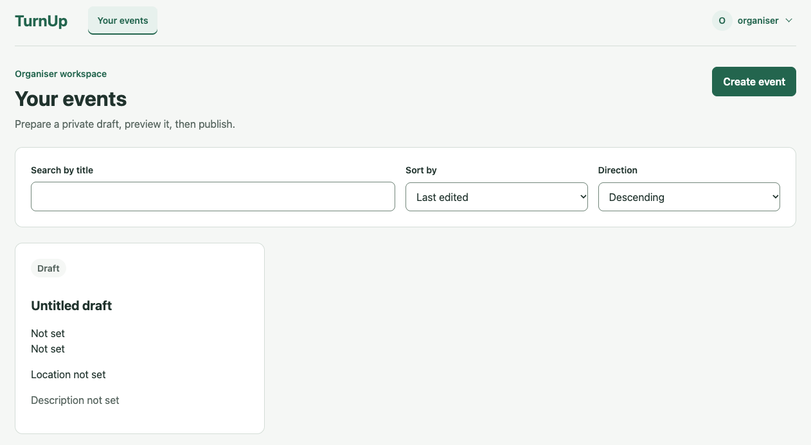
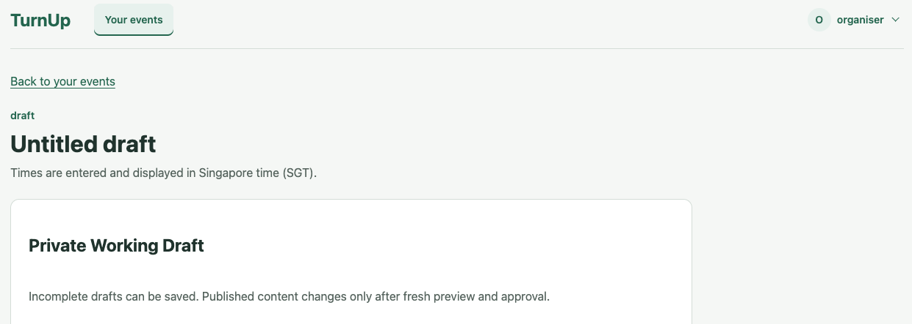

# TurnUp User Guide

TurnUp is a web application for campus events. **Students** discover published events,
register and manage their own submissions. **Organisers** prepare private drafts,
review public content and publish or remove events from discovery.

This guide describes the code at **5393189, 23 October 2026**. Availability on a hosted
deployment also depends on its deployed revision and configuration. Planned features
are listed separately at the end; they are not instructions for working controls.

> **Screenshots:** account and Student captures were supplied by the project team on
> 23 October 2026. The Organiser figures (UG-10 to UG-13 and UG-15 to UG-19) remain marked
> placeholders.
> Screenshots illustrate the displayed interface; they do not establish the deployed
> source revision or replace acceptance-test evidence.

## Contents

- [Getting started](#getting-started)
- [Finding your way around](#finding-your-way-around)
- [Student features](#student-features)
- [Organiser features](#organiser-features)
- [Account settings](#account-settings)
- [Troubleshooting](#troubleshooting)
- [A short tester walkthrough](#a-short-tester-walkthrough)
- [Current limitations](#current-limitations)

## Getting started

### Open TurnUp

Open **[TurnUp](https://turnup-nine.vercel.app/)** in your web browser. No application
download is required. This is the project team's selected Production address; use a
team-provided test deployment if instructed to do so. Different deployments may have
different accounts and event data.

> **Using school Wi-Fi?** If TurnUp does not load, try mobile data or another permitted
> network. Some managed networks may restrict access to Vercel-hosted sites. If the
> problem continues, report the URL and error message to the project team or your
> network administrator. Availability depends on the network; this is not a blanket
> restriction on school networks.

The Production site is publicly accessible. Create a TurnUp account or log in to use
your role's features. The documentation website is separate from the application:
it does not store registrations or sign users in.

### Create an account

1. On the home page, select **Create an account**.
2. Choose **Student** or **Organiser**. Your account has one fixed role; there is no role
   switch after signup. Use separate accounts to test both roles.
3. Enter a username containing 3–32 ASCII letters, digits or underscores. It is stored
   in lowercase, and equivalent usernames cannot be registered twice.
4. Enter a password containing 15–128 Unicode characters. Spaces are preserved; common
   passwords from the application's starter blocklist are rejected.
5. Select **Create account**. Success signs you in and opens your role's workspace.

Signup requires only username, password and role. A Student's optional global profile
can be filled in later.
The eye control shows or hides the password while you enter it.

*Figure UG-01. Create an account by choosing a role and entering your credentials.*

### Log in and out

Select **Log in**, enter your username and password, then select **Log in**. The stored
role determines the destination; there is no login role selector. Repeated attempts may
temporarily be limited. Wait before retrying instead of repeatedly submitting.

Open the account menu at the upper right and select **Log out** when finished. Logging
out ends the current session. Sessions also expire after 30 minutes of inactivity or
eight hours from issue. If a protected operation asks you to log in again, do so before
continuing. A password change signs you out on all devices.

*Figure UG-02. Enter your credentials to log in.*

*Figure UG-02. Open the account menu to access settings or log out.*

## Finding your way around

| Location | Purpose |
| --- | --- |
| **TurnUp** brand | Returns to your role's workspace. |
| **Discover events** | Student search and upcoming/started-event browsing. |
| **My Events** | Your own registrations, available corrections and cancellation. |
| **Your events** | Organiser-owned drafts and previously published events. |
| Account menu → **Profile** | Account settings; Students also see their optional profile. |
| **Back to event / Back to My Events / Back to your events** | Returns from a contextual screen. |

The navigation follows your fixed role. Organiser controls do not appear in a Student
workspace, and knowing another role's URL does not grant access. On smaller screens,
the primary navigation wraps beneath the brand and account menu.

## Student features

### Discover events

1. Open **Discover events**.
2. Type part of an event title into **Search by title**. Matching ignores letter case.
   Searches are limited to 150 characters; the page explains invalid input.
3. Use **Show events** to choose **Upcoming** or **Started / past**.
4. Select a card to open that event. Results are ordered by start time, earliest first,
   and dates are displayed in Singapore time (SGT).

Only currently published events appear. An empty result is not a service error: clear
the search or change the event filter. **Refresh list** fetches current results. Cards
show the title, start, location, fee text and organiser; remaining places and your own
registration status appear when available.

*Figure UG-03. Search and filter published events. This capture shows the top of an upcoming event card.*

### Review an event

The details screen shows the published title, organiser, schedule, purpose/description,
location or participation instructions, fee status, eligible audience, preparation and
any FAQ/Other text. The registration panel shows capacity, remaining places and your
own status. Use **Refresh event** to check current information.

- **Continue to registration** opens the form; it does not reserve a place.
- **Manage your registration** opens My Events when you already hold a place.
- A full event has no join action. A started event is closed for registration changes
  under its current schedule.
- A withdrawn or cancelled event is unavailable through Student details/discovery.
- Fees are information supplied by the Organiser. TurnUp does not take payments.

*Figure UG-04. Review the event and available places before registration.*

*Figure UG-04. After registering, the panel confirms your place and provides registration management.*

### Register for an event

1. Select **Continue to registration** on an upcoming event with available places.
2. Review or enter your **Name** and **Phone number or Telegram handle**. Both are
   required for this event even if your global profile is empty.
3. If supplied by the published form, answer its questions. Supported controls are short
   text, long text, a single choice and multiple choices. Complete every required answer;
   optional single-choice answers have a **Clear choice** control.
4. Tick **I confirm sharing my details and answers with the organizer.**
5. Select **Confirm and register**. Only a successful submission saves a place.
6. On **Registration saved**, select **View My Events** to check your current status.

A phone number must contain 7–15 digits after permitted separators are removed; an
initial `+`, spaces, hyphens and parentheses are accepted. A Telegram handle starts
with `@` followed by 5–32 letters, digits or underscores. Names allow up to 100
characters. A form can contain zero questions; the required event contact and sharing
confirmation still apply.

Opening the form holds no seat. If another Student takes the last place, or the event
or form changes before your submission, the server may reject it. Read the feedback,
return to current event information and review again. Repeated clicks are disabled
while submitting. If the response is uncertain, check My Events before starting a new
registration attempt.

*Figure UG-05. Review your event-specific contact details and confirm sharing before registering.*

*Figure UG-06. A successful submission displays Registration saved. Open My Events to check current status.*

### My Events: check, correct, cancel and re-register

Open **My Events** and use **Refresh My Events** to check current state. Each record
shows **Registered** or **Registration cancelled**. Published events may show fields
that changed since you joined; an active place is preserved by publication edits.
Withdrawn/cancelled records show an unavailable notice rather than old public excerpts.

| Action | When it is available | Result |
| --- | --- | --- |
| **View current event** | The event remains published. | Opens its current public details. |
| **Correct submission** | Your registration is active, the event is published and it has not started. | Opens the form and values captured for your submission. |
| **Cancel registration** | Your registration is active, the event is published or withdrawn and it has not started. | Cancels your place after a successful update. |
| **Register again** | You cancelled, the event is published, has not started and has room. | Opens a fresh registration using the current published form. |

For a correction, edit your contact/answers, confirm sharing again and select **Save
corrected submission**. It uses the form wording you originally submitted, even if the
Organiser later publishes another form. Correction does not take another place.

There is no undo button for a successful cancellation and no held seat afterwards.
Re-registration depends on current availability. Registration, cancellation,
re-registration and correction all stop when the event starts. Editing your optional
profile does not update these captured event submissions.

*Figure UG-07. Manage an active registration from My Events.*

*Figure UG-08. Update the captured submission for this event.*

### Ask the event assistant

When enabled for the deployment, **Ask about this event** appears on an event page.
Open it, enter a question of up to 1,000 characters and select the arrow labelled
**Send question**. Enter sends; Shift+Enter inserts a new line. The assistant currently
supports future-start published events and uses their approved public details and
published form wording, not live remaining places or your submitted answers.

Replies are short conversational text. If a fact is absent, the assistant may say it
cannot confirm it and suggest checking with the Organiser. Clarification, unrelated
questions and technical failures have separate outcomes. Asking to join does not
register you. Use the registration form to obtain a place.

**Hide chat**, the close control or Escape closes the panel. Opening chat or returning
to the window checks source availability without automatically asking another question.
If published information changes, old replies are invalidated. If a recovery control
appears, **Refresh event information** checks the source; it is not an inference retry.
**Try again** explicitly retries a failed question when offered.

Up to 20 recent saved turns for your account, selected event and current publication
can be restored. Closing chat or logging out does not itself erase them. A changed
publication, unavailable event, expiry or a history-service failure may prevent their
display. History is not sent to the model as conversation context: make a new question
self-contained rather than relying on “what about that?”.

Availability is bounded. Current hosted code limits a Student to 20 admitted requests
per rolling 15 minutes, with shared spacing and a finite deployment-wide allowance.
Failures may consume allowance. A busy or unavailable assistant is not evidence that
an event fact is absent. You can still read public event information.

*Figure UG-09. The supplied capture is labelled Live AI in the interface. The reply gives the published start time and asks the Student to check with the organiser about a separate reporting time.*

## Organiser features

### Find and create your events

**Your events** contains only events owned by your Organiser account. Search by title
and sort by **Title**, **Last edited** or **Start time**, in either direction. Select
an event card to open it. **Create event** creates a new private, initially incomplete
draft. Drafts may be saved before every publication field is complete.

Each card shows the event's state (**draft**, **published**, **withdrawn** or
**cancelled**), its schedule, location and a short description excerpt. A **Saved
changes** badge means a previously published event has private saved edits that are not
yet public. A card may also show a [private draft deadline](#private-draft-retention)
warning. If the list fails to load, use **Refresh list**. If **Create event** reports an
error, refresh the list before retrying: the draft may already have been created.

*Figure UG-10. Organiser Dashboard view*

### Prepare a private draft

The editor groups fields under **Event details**, **Participation** and **Additional
information**. Enter the title, purpose/description, location/participation instructions,
start/end, fee status, audience, preparation and capacity. FAQ/Other is optional. Use
explicit text such as “Free” or “None” where appropriate; blank required fields do not
mean free entry or no prerequisites.

| Field | Maximum |
| --- | --- |
| Title | 150 characters |
| Purpose / description | 4,000 characters |
| Location / participation instructions | 1,000 characters |
| Fee status | 500 characters |
| Open to | 1,000 characters |
| Prerequisites / preparation | 2,000 characters |
| FAQ / Other | 4,000 characters |
| Capacity | Whole number from 1 to 10,000 |

Public content also has combined character/byte limits; character counters do not
override those checks. Enter times in **Singapore time**. End must follow start.
First publication and republication require a future start. An already published
event may retain an unchanged past start for content-only updates; a changed start
must be in the future.

Select **Save Draft** to persist privately. **Cancel Editing** discards unsaved edits;
**Discard saved changes** restores the working draft from the last publication after
confirmation. These are different from cancelling an event. Leaving an edited draft
through a navigation link asks whether to discard unsaved edits.

*Figure UG-11. Event Draft page*

### Prefill a draft from a proposal PDF

**Proposal assistance** sits at the top of the private working draft. It can read an
event proposal PDF and suggest values for the title, purpose/description, start, end,
location, capacity, fee status, audience and preparation fields. FAQ/Other is not
prefilled from the proposal. Availability depends on the deployment: the
[daily allowance](#daily-generation-allowance) line under the controls says whether
hosted generation is enabled.

1. Open a draft (or **Edit Live Publication**) so the **Private Working Draft** is shown.
2. Select **Choose PDF** and pick the proposal. Choosing a file sends nothing; the
   status line shows its name and size.
3. Select **Generate Findings**. The PDF is uploaded for temporary text extraction and
   the embedded text is sent to the configured AI service. Editing controls wait while
   generation runs.
4. Review each field. Its feedback beneath the input tells you what happened:
   - **Prefilled from the proposal** with quoted source evidence and page numbers.
     Editing that field removes its evidence display.
   - **No supported value was found** or **No safe value was returned**: the existing
     field was kept. Complete it manually.
   - **Not prefilled**: a value was found but failed a field rule (an incomplete date
     and time, a capacity outside 1–10,000 or text over the field limit). The existing
     field was kept.
   - **Conflicting values**: choose one of the **Use …** buttons, each with its evidence,
     or edit the field yourself.
5. Read **Private findings** and any **Private review notes**. They are for you only and
   are never published.
6. Select **Save Draft** to keep accepted values. Generated values are not saved until
   you do.

Requirements: a PDF of up to **4 MB** and **20 pages** with selectable embedded text.
Scanned/image-only and password-protected PDFs are rejected. Dates and times without a
stated timezone are interpreted as Singapore time; check the converted value against the
quoted evidence.

What is kept: the PDF and its full extracted text are **not** saved. Structured
clarification questions and their short evidence quotes are saved privately with the
draft. Other generated evidence disappears when you leave or refresh the page.
**Remove proposal** clears the selected file and on-screen findings; values already placed
in the working draft stay there. Fields you have already confirmed in a clarification are
not overwritten by a later generation.

If the event changes in another tab while findings are being generated, TurnUp refuses to
apply the result and asks you to generate again. A failed request leaves your fields
unchanged.

### Resolve proposal clarifications

When a proposal is missing a value, gives conflicting values or offers a value that needs
your confirmation, the editor shows **Clarification needed (*n*)** with a linked list of
questions such as “When does the event start?”. Each question also appears beneath its
field.

- Select **Use …** to adopt a supported suggestion, shown with its source quote and page.
- Or type your own answer in the field and select **Confirm this value**.
- If you later change a confirmed value, the question reopens and asks for confirmation
  again. A later proposal that disagrees with your confirmed value also reopens it.

You can **Save Draft** while questions remain; your confirmations are saved with it.
**Preview saved draft** stays disabled until every clarification is resolved and saved.

### Generate FAQ suggestions

**FAQ suggestions** proposes likely attendee questions using only the **saved** event
details. Proposal PDFs, private findings and clarification notes are not included.

1. Complete every required field, a valid future schedule and capacity. Resolve all
   clarifications and select **Save Draft**. The button stays disabled while you have
   unsaved edits, and a hint explains what is missing.
2. Select **Generate FAQ suggestions**.
3. Review the result:
   - Supported answers are shown with references to the saved fields they came from.
   - **Questions needing your answer** have no supported answer in your details. Type an
     answer and select **Add answered question to FAQ / Other suggestion** to include it.
     Unanswered questions are never added automatically.
   - You can edit the **Editable FAQ / Other** text directly (up to 4,000 characters).
4. Select **Apply FAQ / Other to working form**. If the field already has different text,
   you will be asked to confirm the replacement. Other fields are untouched.
5. Select **Save Draft**. Applying does not save or publish anything. Preview and approve
   as usual.

**Dismiss suggestions** discards the candidate without changing the event. If the saved
event or its fields change while suggestions are prepared, they are not applied; save or
reload, then generate again. Only one suggestion can be applied per saved version.

### Daily generation allowance

Proposal extraction and FAQ suggestions share one daily allowance per Organiser account
in each environment, across all your events and sessions.
The line under each tool shows what remains, for example *“Your Preview daily allowance
has 9 of 10 generation attempts and 36,864 of 40,960 reserved output tokens remaining… resets
at … SGT.”*

- Each request sent to the AI service uses one attempt and reserves 4,096 output tokens,
  whatever the response length or outcome. The current limit is 10 attempts per
  Singapore day. Requests rejected before sending (for example an unreadable PDF or an
  out-of-date event) do not use an attempt.
- The allowance resets at midnight Singapore time. There is no automatic retry or manual
  reset.
- Requests are briefly spaced, and only one generation may run at a time in each
  environment. Messages such as “A generation request is already in progress” or
  “Generations are briefly spaced” ask you to wait, not to change your draft.
- “Hosted AI generation is currently disabled in this environment” means the deployment
  has not enabled these tools. You can still create and publish events manually.

### Private draft retention

Private draft material is kept for **30 days** after its last activity. **Save Draft** or a
successful proposal extraction restarts the 30-day period. In the final 7 days, the
event card and editor show **Private draft expires soon** with the deadline in SGT; after
the deadline they show **Private draft deadline passed** until cleanup runs.

| Event | What happens after the deadline |
| --- | --- |
| Never published draft | The draft and its proposal preparation are deleted. |
| Published or withdrawn event with saved private changes | Private changes and preparation are cleared; the working draft is restored from the latest publication. The publication, state, history and registrations remain. |
| Cancelled event | Its private changes and proposal preparation are cleared. The cancelled state, publication history and registrations remain. |

To keep a draft, open it and select **Save Draft** before the deadline. Cleanup runs on a
schedule, so expiry makes material eligible for removal rather than removing it at an
exact instant.

### Preview and publish

1. Save your draft. Unsaved edits must be saved and any
   [proposal clarifications](#resolve-proposal-clarifications) resolved before previewing.
2. Select **Preview saved draft**. Required-field or timing errors must be corrected.
3. Read **Public Preview**, including any published registration form.
4. Tick **I reviewed and approve this exact public content.**
5. Select **Publish approved event** (or **Republish approved event** after withdrawal).

Approval covers that saved snapshot. If another tab changes the event or refreshes
its approval, reload and preview again. Publication can also reject a capacity lower
than the number of active registrations. A preview or checked checkbox alone does not
mean the event is published.

### Edit, withdraw, cancel or delete

Previously published events open on **Current Live Publication** or **Last Publication**.
Select **Edit Live Publication** (or **Edit for republication** on a withdrawn event) to
change the private working draft, then save, preview and approve again. Until successful
publication, Students see the previous public revision. A **You have saved private
changes** notice means the working draft differs from what is shown. If an action fails
because the event changed elsewhere, use **Reload saved values** and review again.

| Control | Effect |
| --- | --- |
| **Withdraw** | Makes a published event unavailable publicly. The owner can edit and review it for republication. |
| **Cancel Event** | Permanently cancels a published/withdrawn event. It cannot be republished. |
| **Delete draft** | Permanently removes a draft that has never been published. Previously published events cannot use this action. |
| **Discard saved changes** | Restores private fields/form from the last publication; does not delete the event or publication. |

Read the native confirmation carefully: it names the event and the consequence.
Cancelling an event is distinct from a Student cancelling one registration. Organisers
cannot register through their Organiser account.

## Account settings

Open the account menu and select **Profile**. Both roles can edit username/password;
Students additionally see **Student profile**.

- **Username:** select Edit, enter the replacement and current password, then Save.
  A successful actual rename keeps you signed in and preserves event/registration
  ownership. Duplicate names and stale edits fail rather than overwriting another user.
- **Password:** select Change, enter the current password and matching new passwords,
  then Save. An actual password change signs out **all devices**. Log in using the new
  password. Saving the unchanged canonical value does not revoke sessions.
- **Student profile:** edit Name or Phone number separately; both are optional.
  Leaving a field blank removes it. The profile phone field accepts phone numbers,
  not Telegram handles; the event-specific contact field also accepts Telegram.
  Changes affect future prefills and do not rewrite earlier event submissions.
- **Cancel** closes the inline editor. Conflict feedback may offer **Reload saved
  values for review** or **Reload settings** before saving again.

*Figure UG-14. Account settings provides credential controls and optional profile editing. This capture shows the upper portion of the page.*

## Troubleshooting

| What you see | What to do |
| --- | --- |
| Page will not load on school Wi-Fi / connection timeout | Try mobile data or another permitted network. If it works there, report the affected network, URL and exact error to the project team or network administrator. A network-specific failure does not identify its cause by itself. |
| Account access is unavailable | Retry later and report the page/time to the team. It is a service/configuration failure, not proof of invalid credentials or database quota exhaustion. |
| Invalid login / duplicate username | Recheck credentials or choose a different username. |
| Too many attempts | Wait for the relevant limit window; repeatedly clicking does not reset it. |
| Event changed / stale form | Refresh current information and review before a new operation. Check My Events if an earlier submission may have succeeded. |
| No events / no matching events | Clear search, change Upcoming/Started / past, or ask the Organiser to publish an event. |
| Event unavailable | It may have been withdrawn/cancelled or access may be unavailable. Return to discovery/My Events. |
| No registration action | Check full/started/already-registered status. Only eligible actions appear. |
| Assistant unavailable / busy / took too long | Read the published details; wait or use an explicit retry when offered. Do not treat the failure as an answer about the event. |
| Organiser: “No readable embedded text was found” / PDF rejected | Use a text-based PDF (not a scan), under 4 MB, up to 20 pages and without a password, or fill the fields manually. |
| Organiser: Preview saved draft or Generate FAQ suggestions is disabled | Save unsaved edits, complete required fields with a future start, and resolve every item under Clarification needed. |
| Organiser: generation limited / already in progress | Wait for the stated time or the next SGT day. Generation failures leave event fields unchanged. |
| Organiser: “Hosted AI generation is currently disabled” | The deployment has not enabled proposal/FAQ tools. Complete the draft manually. |
| Organiser: “Private draft expires soon” | Open the event and select Save Draft to restart the 30-day period. |
| Saved conversation could not be loaded | Existing history is not currently available for display. A fresh question may still be possible; do not assume it erases saved records. |

## A short tester walkthrough

Use two **synthetic** accounts, one per role, and a demonstration event on the team's
designated test deployment. There are no built-in demo
credentials. Do not enter real attendee details or use Production destructive actions
to test error cases.

1. As Organiser, create a future event with capacity 2, explicit fee/audience/preparation
   text and complete required fields. Save, preview, approve and publish it.
2. Log out; sign in as Student. Find the event, inspect details and register with
   synthetic contact values plus sharing confirmation.
3. Check My Events. Correct a submission before start and verify the success summary.
   Change your optional profile and confirm that the earlier submission is independent.
4. As Organiser, change the published event's location through save/preview/publish.
   If proposal assistance is enabled and budget is authorised, try one synthetic proposal
   PDF on a new draft: check field evidence, resolve one clarification and confirm that
   preview is blocked until it is saved. Do not publish that fixture.
   As Student, refresh and check the change notice and preserved place.
5. On a disposable test registration, cancel and, if room remains, register again.
6. If AI testing and budget are authorised, ask one source-supported question and one
   absent-fact question. Check clear uncertainty and that no automatic registration or
   private message is claimed. Skip live requests if allowance/access is unavailable.
7. Log out and check that protected pages/operations require authentication again.

Record what actually happened, the deployment/revision, browser and any error. This
walkthrough is a testing procedure, not a claim that the complete flow has passed.

## Current limitations

The documented code does **not** provide an Organiser form-builder or roster screen, a private question inbox/reply workflow,
automatic forwarding, an Organiser-contact button, email notifications,
role switching, payments, a waitlist or seat holds. The registration engine
supports versioned custom forms, but that does not create a form-builder interface.

Organiser proposal assistance reads embedded PDF text only (no OCR for scans) and does
not fill FAQ/Other from the proposal. Proposal and FAQ tools may be disabled on a given
deployment; at this revision hosted generation was rolled out for Preview testing, and
Production remained disabled. Generated values and suggestions are prompts for your
review, not verified facts.

The Student assistant currently refuses started/past-event sources and publications exceeding
its source-size limit. Budget/key/configuration problems may hide or disable it.
Quoted evidence is checked internally; it is not shown as a source panel and does not
guarantee that every generated sentence is semantically correct. Use published details
and the Organiser to resolve important uncertainties.

For setup, data/security design, supported tests and pending integration work, see the
[Developer Guide](DeveloperGuide.md).
